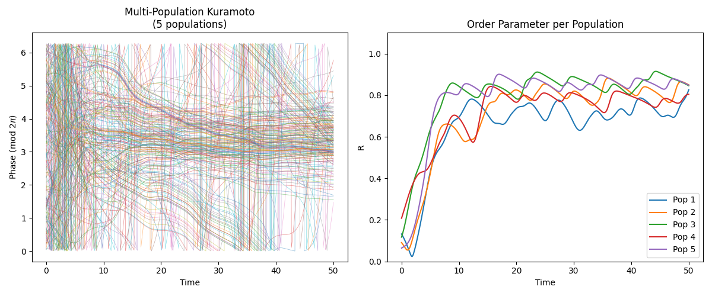
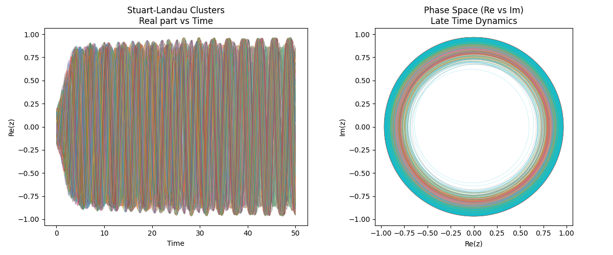
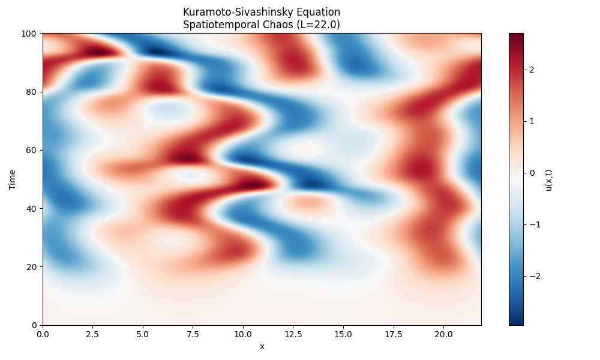

# Dynamics, Time Series & World Models

A research and simulation lab connecting **dynamical systems**, **time-series foundation models**, and **world-action models**. This repository pairs NumPy/Numba oscillator simulations with an interactive field guide to what models take in, what they predict, and what the evidence does (and does not) establish.

## Start with the interactive field notes

| Field note | Question | Explore |
|---|---|---|
| **Time-Series Foundation Models** | How can a model turn numerical history into a useful forecast on a new series? | [Read the paper study](https://dipayandey1244.github.io/time-series-foundation-model/time-series-paper-study.html) |
| **World-Action Models** | How can an agent connect incomplete observations, possible actions, and their consequences? | [Open the World Model Lab](https://dipayandey1244.github.io/time-series-foundation-model/kairos_time_series_lab.html) |

The [homepage](https://dipayandey1244.github.io/time-series-foundation-model/) introduces time-series, vision, and world-action models, then links the two research paths. The field notes use animated, step-by-step explanations. The equations below are compact maps of each field, not claims that every model shares one architecture.

## The equations behind the field notes

### 1. Time-series forecasting

$$
\hat{y}_{t+1:t+H} = f_\theta(y_{1:t})
$$

The observed context $y_{1:t}$ ends at time $t$. A learned forecasting function $f_\theta$, with parameters $\theta$, maps that history to estimates for the next $H$ time steps. Some foundation forecasters also represent uncertainty or return quantiles; this expression shows the basic history-to-horizon relationship.

### 2. Promptable vision

$$
\hat{M}_{1:T} = f_\theta(X_{1:T}, q)
$$

Here $X_{1:T}$ is an image or sequence of video frames, $q$ is a prompt specifying the object or concept, and $\hat{M}_{1:T}$ is the predicted segmentation mask sequence. A mask marks selected pixels; it is not itself a complete scene understanding.

### 3. World-action models

$$
(\hat{A}_{t:t+H}, \hat{O}_{t+1:t+H}) \sim
p_\theta(A_{t:t+H}, O_{t+1:t+H} \mid O_{1:t}, g)
$$

A model samples a candidate action sequence $\hat{A}$ together with future observations $\hat{O}$, conditioned on observation history $O_{1:t}$ and goal $g$. This is **schematic family-level notation**: particular world-action models predict different combinations of actions, states, video, or other outputs.

The common thread is prediction from context. A time-series model asks what values may come next; a world-action model asks what may happen under a possible action.

## Oscillator environments

The numerical examples are 200-state systems with structure intended to make collective behavior easier to see. Each oscillator remains an individual state; the lower-dimensional descriptions below are hypotheses about emergent group behavior, not a guarantee that every run lands on an exact low-dimensional manifold.

### 1. Multi-population Kuramoto model

Implemented in [environment/kuramoto.py](environment/kuramoto.py).

$$
\dot{\theta}_i = \omega_i +
\sum_{j=1}^{N} K_{ij}\sin(\theta_j-\theta_i),
\qquad i=1,\ldots,N
$$

- $N=200$ phase oscillators are divided into five populations of 40.
- The coupling matrix is block-structured: intra-population coupling is stronger than inter-population coupling. The stored matrix is divided by $N$ before integration.
- Natural frequencies are drawn from a normal distribution; random initial phases spread oscillators around the circle.
- The population order parameter
  $$
  R_c(t)=\left|\frac{1}{N_c}\sum_{j\in c}e^{i\theta_j(t)}\right|
  $$
  summarizes synchrony within population $c$: values near 1 indicate aligned phases; lower values indicate dispersion.

[Open the Kuramoto result image](visualizations/kuramoto_results.png) · [simulation script](visualizations/vis_kuramoto.py)

<strong>How to read and reproduce this figure</strong>

The image has two views of the same trajectory:

1. **Build the communities.** Create the 200-by-200 block coupling matrix with five strongly coupled groups and weaker links between groups.
2. **Evolve the phases.** Draw natural frequencies and initial phases, then integrate the coupled ODE with the shared fourth-order Runge–Kutta integrator (dt=0.01, t=0…50). The visualization saves every 10 integration steps.
3. **Reveal the collective pattern.** The left panel plots each phase modulo $2\pi$. The right panel plots $R_c(t)$ for each population, so within-group synchronization can be compared directly.

The design encourages five coarse communities; inspect the order-parameter curves to see how strongly they synchronize in the actual run.

### 2. Cluster-synchronized Stuart–Landau network

Implemented in [environment/stuart_landau.py](environment/stuart_landau.py).

$$
\dot{z}_i =
(\lambda_i + i\omega_i)z_i
- |z_i|^2z_i
+ \sum_{j=1}^{N}K_{ij}(z_j-z_i)
$$

The complex state $z_i$ encodes amplitude and phase. The linear term supports growth and rotation, the cubic term limits amplitude near a Hopf bifurcation, and coupling communicates state between oscillators.

- $N=200$ oscillators are arranged in seven groups (six groups of 28 and one of 32).
- The parameters use $\lambda_i=1$ and heterogeneous frequencies centered near 2; the coupling matrix is block-structured and normalized by $N$.
- The visualization uses intra-group coupling 2.0 and inter-group coupling 0.01 (the environment function's default inter-group value is 0.05).
- The shared RK4 integrator uses dt=0.01 over t=0…50, saving every five steps.

[Open the Stuart–Landau result image](visualizations/stuart_landau_results.png) · [simulation script](visualizations/vis_stuart_landau.py)

<strong>How to read and reproduce this figure</strong>

1. **Initialize seven groups.** Create the block coupling matrix and random complex starting states with small amplitudes.
2. **Integrate amplitude and phase together.** Run the coupled complex ODE with RK4; each point in the complex plane is one oscillator's $z_i(t)$.
3. **Read both projections.** The left panel plots $\operatorname{Re}(z_i)$ over time. The right panel traces $(\operatorname{Re}z_i,\operatorname{Im}z_i)$ for late-time samples, coloring oscillators by group. Similar loops within a color indicate cluster-like behavior.

### 3. Kuramoto–Sivashinsky equation

Implemented in [environment/kuramoto_sivashinsky.py](environment/kuramoto_sivashinsky.py).

$$
u_t + u\,u_x + u_{xx} + u_{xxxx}=0
$$

The nonlinear advection term competes with a destabilizing second derivative and stabilizing fourth-order hyper-diffusion, producing rich spatiotemporal dynamics. The solver uses $N=200$ Fourier grid points on a periodic domain of length $L=22$.

In Fourier space, the linear operator has symbol $k^2-k^4$. The code advances that linear part implicitly and the quadratic term explicitly (first-order IMEX Euler):

$$
\hat{u}^{\,n+1}_k =
\frac{\hat{u}^{\,n}_k
-\frac{\Delta t}{2} i k\,\widehat{u^2}^{\,n}_k}
{1-\Delta t(k^2-k^4)}.
$$

[Open the Kuramoto–Sivashinsky result image](visualizations/ks_results.png) · [simulation script](visualizations/vis_ks.py)

<strong>How to read and reproduce this figure</strong>

1. **Set the periodic grid.** Choose $L=22$, $N=200$, and initialize small mean-zero noise in Fourier space.
2. **Advance the Fourier modes.** Use dt=0.001 over t=0…100; save every 50 steps. The linear Fourier term is handled implicitly while the nonlinear product is evaluated in physical space and transformed back.
3. **Return to physical space.** Apply the inverse FFT to each saved state. The heatmap shows $u(x,t)$: horizontal position is space, vertical position is time, and color is field value.

The project description targets a chaotic attractor with an estimated Lyapunov dimension around 5–10. The plotting script does **not** calculate Lyapunov dimension; treat that range as a modeling target until a dedicated estimate is added.

## Runtime and installation

The ordinary ODE loops use NumPy-compatible code and Numba's <code>@njit</code> compilation; this avoids requiring a JAX binary compatible with a particular CPU architecture. The Kuramoto–Sivashinsky solver uses NumPy FFTs and a Fourier-space update. Numba compilation can make the first run slower while the compiled integrator is prepared.

    python3 -m venv .venv
    source .venv/bin/activate
    python -m pip install -r requirements.txt

Generate the three figures:

    python visualizations/vis_kuramoto.py
    python visualizations/vis_stuart_landau.py
    python visualizations/vis_ks.py

Each script writes a PNG into <code>visualizations/</code>. Click a result link above to inspect the full-resolution image; expand its walkthrough to see the simulation and plotting steps. For animated, interactive explanations of the foundation-model equations, use the [field notes](https://dipayandey1244.github.io/time-series-foundation-model/).

## Reading the claims carefully

- **Designed dimensions are not measured dimensions.** Five or seven clusters are structural choices; use synchrony statistics and trajectories to judge the realized dynamics.
- **The KS dimension estimate is not computed by the current scripts.** A Lyapunov-dimension claim needs a dedicated numerical estimator and convergence checks.
- **Integration choices are model-specific.** The two oscillator networks use fixed-step RK4; KS uses a first-order IMEX Euler step. Neither method makes accuracy automatic: verify time-step and resolution sensitivity for quantitative conclusions.
- **A foundation-model forecast is not a guarantee.** Evaluate on the target domain and compare with simple baselines.

## Repository map

    environment/
      kuramoto.py                 Multi-population phase oscillators
      stuart_landau.py            Coupled complex oscillators
      kuramoto_sivashinsky.py     Fourier pseudo-spectral KS solver
      integrators.py              Numba-compiled RK4 integrator
    visualizations/
      vis_kuramoto.py             Simulation and Kuramoto figure
      vis_stuart_landau.py        Simulation and Stuart–Landau figure
      vis_ks.py                   Simulation and KS figure
      *_results.png               Generated result figures
